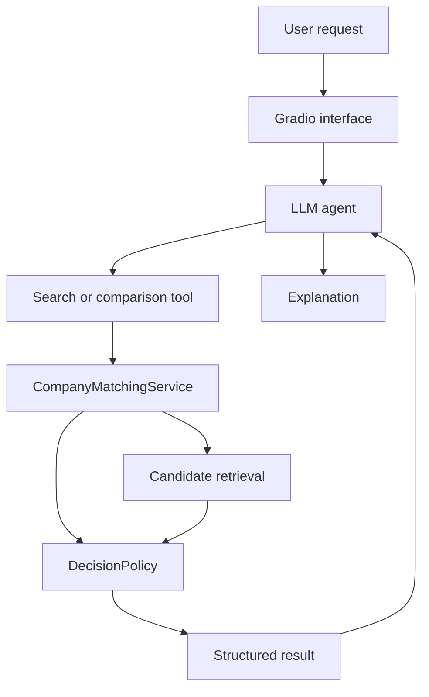

# Company Name Matching Agent
A prototype entity-resolution application for matching noisy, misspelled, or abbreviated organization names against a canonical company database. The system combines deterministic candidate retrieval and decision rules with an LLM agent that routes natural-language requests and explains structured matching results.

The LLM does not determine whether companies match. Candidate scores and MATCH, POSSIBLE_MATCH, or NO_MATCH decisions are produced by the deterministic matching service.


## Motivation

Organization names are rarely recorded consistently across real-world datasets. The same company may appear under abbreviations, misspellings, alternative word orderings, or different corporate suffixes. For example, `JPMorgan Chase & Co.`, `JP Morgan Chase`, and `JPMorgan` may all refer to the same organization. These inconsistencies make it difficult to join datasets, remove duplicate records, aggregate information, and maintain reliable company databases.

This project explores an LLM-assisted approach to company-name resolution. A deterministic matching service retrieves ranked candidates, evaluates score thresholds and candidate ambiguity, and returns a structured result. An LLM agent interprets natural-language requests, selects the correct matching tool, and explains the deterministic result without overriding it.

Current development focuses on evaluating retrieval performance, calibrating the decision thresholds, expanding the canonical database, and supporting batch matching workflows.


## Key Features

- **Natural-language interface:** Submit matching requests through an interactive Gradio application.
- **Canonical database search:** Retrieve up to three ranked candidates for a noisy or abbreviated company name.
- **Pairwise comparison:** Compare two supplied company names using deterministic similarity scoring.
- **Structured results:** Return typed `Candidate`, `SearchResult`, and `ComparisonResult` objects.
- **Three-way decision policy:** Classify results as `MATCH`, `POSSIBLE_MATCH`, or `NO_MATCH`.
- **Ambiguity detection:** Require both a strong top score and sufficient separation from the runner-up before automatically accepting a database match.
- **Duplicate-candidate filtering:** Prevent multiple securities or duplicate matcher outputs from appearing as separate candidate companies.
- **Controlled agent behavior:** Treat the matching service’s decision as authoritative; the LLM may explain but not upgrade or override it.
- **Reproducible evaluation data:** Generate seeded, entity-disjoint calibration and test queries from SEC company names.
- **Automated testing:** Exercise matching, ranking, decision-policy, result-serialization, and tool behavior with `pytest`.
- **Environment-based configuration:** Load API credentials from `.env` rather than source code.


## Architecture

The application separates natural-language orchestration from deterministic entity resolution.



### Component responsibilities

- **Gradio interface:** Provides the browser interface and passes requests to the agent.
- **LLM agent:** Interprets natural-language requests, selects the relevant tool, and explains the returned result.
- **Agent tools:** Thin wrappers around the shared matching service.
- **`CompanyMatchingService`:** Loads canonical data, retrieves and deduplicates ranked candidates, and creates structured results.
- **`DecisionPolicy`:** Applies score thresholds and candidate-margin rules.
- **Matching engine:** Normalizes names and calculates deterministic string-similarity scores.

This separation prevents changes in LLM behavior from silently changing matching scores or acceptance rules.


## Decision Policy

A canonical-database search considers both the best candidate’s score and its margin over the second-best distinct candidate.

The current provisional defaults are:

| Parameter | Default | Purpose |
|---|---:|---|
| `match_threshold` | 85 | Minimum top score for an automatic match |
| `possible_threshold` | 65 | Minimum score for manual review |
| `minimum_margin` | 10 | Required separation from the runner-up |

The policy behaves approximately as follows:

| Condition | Decision |
|---|---|
| Top score below the review threshold | `NO_MATCH` |
| Top score within the review range | `POSSIBLE_MATCH` |
| High top score but small candidate margin | `POSSIBLE_MATCH` |
| High top score with sufficient margin | `MATCH` |

These values are provisional. The evaluation pipeline described below is being used to calibrate them from labeled examples rather than choosing them from a few demonstration queries.


## Example Results

The following end-to-end checks were run locally against the demonstration database:

| Request | Operation | Deterministic result |
|---|---|---|
| Are `J.P. Morgan` and `JPMOrgan` the same company? | Pairwise comparison | `MATCH`, score 89.55 |
| Find `JPMOrgan` in the canonical database | Canonical search | `POSSIBLE_MATCH` with `JPMorgan Chase`, score 69.05 |
| Is `Lasarium` in the canonical database? | Canonical search | `NO_MATCH`, best score 24.94 |

The second result is deliberately not upgraded to `MATCH`. The matching service returned `POSSIBLE_MATCH`, so the agent reports the candidate and recommends manual review.

Similarity scores depend on the canonical database and matcher configuration. They are not calibrated probabilities.

## Evaluation Methodology

### Canonical data

The evaluation pipeline begins with the SEC's `company_tickers.json` dataset. Each SEC Central Index Key (CIK) is converted into a stable identifier such as:

```text
sec_0000320193
```

The preprocessing stage:

1. extracts the CIK, official company name, and ticker;
2. zero-pads the CIK and uses it as `company_id`;
3. removes duplicate CIK records so one entity cannot appear repeatedly because it has multiple securities;
4. preserves the SEC's original capitalization; and
5. writes the processed canonical database as CSV.

The raw downloaded SEC file is not required in version control. The preprocessing script provides the reproducible conversion step.

### Synthetic corruption protocol

The evaluation generator samples canonical companies and produces noisy queries while retaining the correct `company_id`.

| Transformation | Example |
|---|---|
| Lowercasing | `ACME INDUSTRIES` → `acme industries` |
| Punctuation removal | `ACME, INC.` → `ACME INC` |
| Legal-suffix removal | `ACME INDUSTRIES INC.` → `ACME INDUSTRIES` |
| Whitespace removal | `ACME INDUSTRIES` → `ACMEINDUSTRIES` |
| Character deletion | `INDUSTRIES` → `INDUSRIES` |
| Character substitution | `INDUSTRIES` → `INDUSXRIES` |
| Adjacent-character swap | `INDUSTRIES` → `INDUSTRISE` |
| Token removal | `ACME INDUSTRIAL GROUP` → `ACME GROUP` |

The default generation configuration uses:

- 1,000 sampled companies;
- one unchanged baseline query per company;
- four valid corruptions per company;
- a fixed random seed of `42`; and
- an 80/20 calibration/test split.

This produces up to approximately 5,000 positive labeled queries. Transformations that do not change a particular name are discarded.

### Entity-disjoint splitting

Companies are assigned to a split before corruptions are generated. Every variant of a company therefore belongs entirely to either the calibration split or the test split.

- **Calibration split:** Used to select `match_threshold`, `possible_threshold`, and `minimum_margin`.
- **Test split:** Kept untouched until the decision policy has been finalized.

This prevents tuning the policy on one corrupted form of a company and then evaluating it on another form of the same company.

### Planned metrics

The evaluation will report:

- Recall@1;
- Recall@3;
- automatic-match precision and recall;
- false automatic-match rate;
- manual-review rate;
- correct-candidate coverage among `POSSIBLE_MATCH` results; and
- performance broken down by corruption type.

The current generated dataset contains positive matches. Easy negatives, hard negatives, and a manually reviewed challenge set will be added before final policy calibration. GLEIF Level 1 data is planned as a later international external-validation dataset; it has not yet been included in reported results.

## Testing and Quality Control

The automated test suite covers:

- exact canonical-name retrieval;
- pairwise comparisons;
- structured result serialization;
- candidate ranking by descending score;
- unique company IDs among returned candidates;
- high-score results with sufficient candidate margin;
- high-score results with an insufficient candidate margin;
- tool integration with the shared matching service; and
- preservation of deterministic decisions in agent-facing tools.

Run the tests with:

```bash
PYTHONPATH="$PWD/src" python -m pytest -q
```

All current tests pass locally. Manual end-to-end checks through Gradio also verified that the agent:

1. selects the correct tool;
2. receives the structured result;
3. preserves `MATCH`, `POSSIBLE_MATCH`, and `NO_MATCH` decisions;
4. describes scores as similarities rather than probabilities; and
5. recommends manual review when required.

The evaluation generator was initially smoke-tested on 10 companies, producing 50 labeled queries with no company overlap between the calibration and test splits.

## Quick Start

### Requirements

- Python 3.11 or later
- A Hugging Face account and API token

Docker configuration is included.

### 1. Clone the repository

```bash
git clone https://github.com/JMLeedom/CompanyNameAgent.git
cd CompanyNameAgent
```

### 2. Create a virtual environment

```bash
python -m venv .venv
source .venv/bin/activate
python -m pip install --upgrade pip
python -m pip install -r requirements.txt
```

For development and testing:

```bash
python -m pip install -r requirements-dev.txt
```

### 3. Configure the API token

Copy the example environment file:

```bash
cp .env.example .env
```

Add the token to `.env`:

```text
HUGGINGFACEHUB_API_TOKEN=hf_your_token_here
```


### 4. Run the application

```bash
PYTHONPATH="$PWD/src" python app.py
```

Open `http://localhost:7860` in a browser.

### 5. Run the tests

```bash
PYTHONPATH="$PWD/src" python -m pytest -q
```

### Docker

After revalidating the current Docker configuration:

```bash
docker build --no-cache -t company-name-agent .
docker run --env-file .env -p 7860:7860 company-name-agent
```

## Evaluation Data Pipeline

Convert the SEC JSON file into the canonical CSV:

```bash
python scripts/process_sec_companies.py \
    --input data/raw/company_tickers.json \
    --output data/processed/canonical_companies.csv
```

Generate the positive calibration and test queries:

```bash
python scripts/generate_evaluation_data.py \
    --input data/processed/canonical_companies.csv \
    --output data/evaluation/evaluation_queries.csv \
    --sample-size 1000 \
    --variants-per-company 4 \
    --test-fraction 0.2 \
    --seed 42
```

## Repository Structure

```text
CompanyNameAgent/
├── app.py
├── data/
│   ├── raw/
│   ├── processed/
│   └── evaluation/
├── scripts/
│   ├── process_sec_companies.py
│   └── generate_evaluation_data.py
├── src/
│   └── company_name_agent/
│       ├── matching_service.py
│       ├── decision_policy.py
│       └── ...
├── tests/
├── requirements.txt
├── requirements-dev.txt
├── Dockerfile
└── README.md
```

## Current Limitations

- Decision thresholds are provisional and have not yet been calibrated.
- The current synthetic evaluation data contains positive examples but not a complete set of easy and hard negatives.
- The SEC dataset primarily represents publicly traded companies and is not a complete global entity registry.
- Synthetic corruptions cannot reproduce every real-world alias or data-entry error.
- Similarity scores are not probabilities.
- Agent behavior currently depends on a Hugging Face inference provider.
- Batch CSV matching and manual-review export are not implemented.
- Docker behavior should be revalidated after the recent changes.

## Roadmap

- [ ] Run the matcher over the generated evaluation data
- [ ] Add easy negatives and hard negatives
- [ ] Calibrate thresholds using the calibration split
- [ ] Evaluate once on the held-out test split
- [ ] Add a manually reviewed challenge set
- [ ] Validate internationally using sampled GLEIF entities
- [ ] Display multiple candidates in the UI
- [ ] Add input validation and clearer error handling
- [ ] Support configurable LLM providers
- [ ] Add batch CSV matching and manual-review export
- [ ] Add continuous integration and revalidate Docker deployment

## License

This project is licensed under the [MIT License](LICENSE).